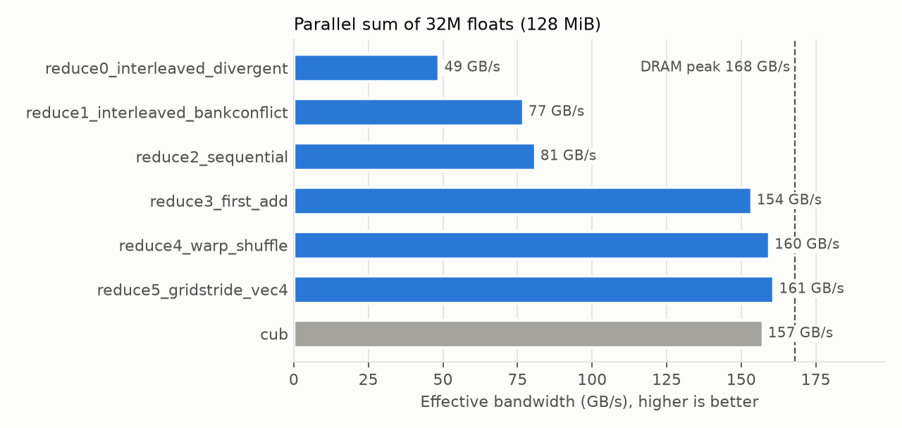
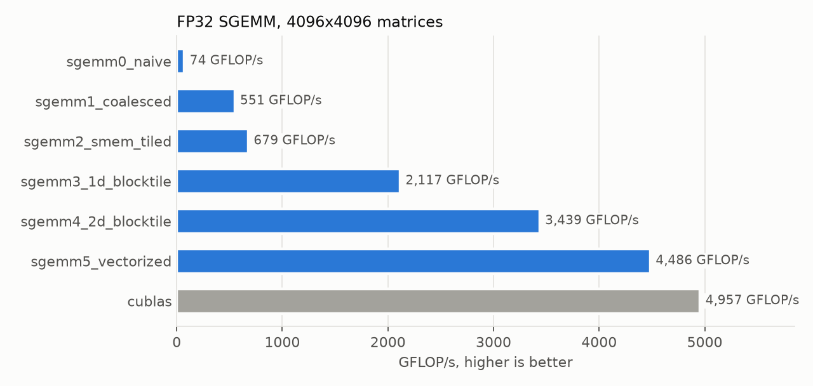
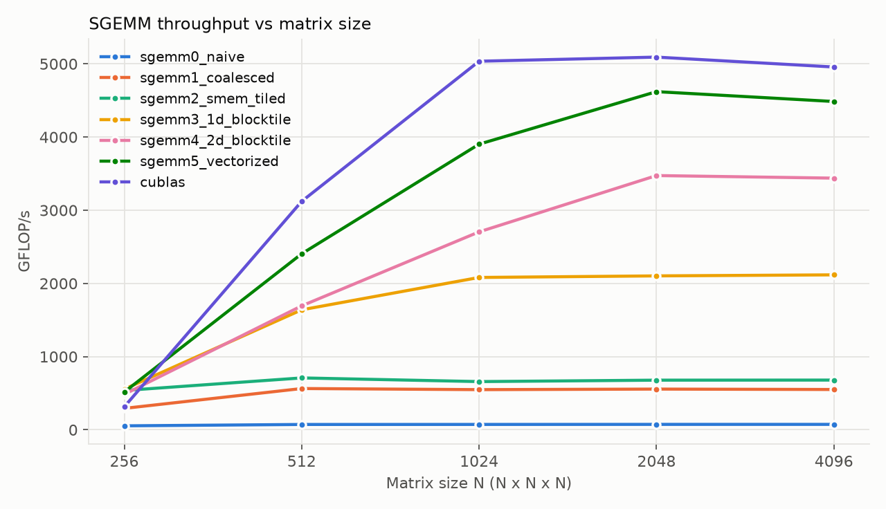

# CUDA kernel optimization: parallel reduction and SGEMM

I wrote two classic GPU kernels from scratch in CUDA C++, each in six versions. Every version fixes the main bottleneck of the one before it. Each kernel is checked for correctness, timed against NVIDIA's own libraries (CUB and cuBLAS) on an RTX 3050 Laptop GPU, and profiled with Nsight Compute to confirm what limits it.

| | Best kernel | Library baseline | vs. naive |
|---|---|---|---|
| **Sum of 32M floats** | 161 GB/s (95.8% of DRAM peak) | CUB: 157 GB/s | 3.3x faster |
| **SGEMM 4096×4096, FP32** | 4,486 GFLOP/s | cuBLAS: 4,957 GFLOP/s (my kernel reaches 90.5%) | 60x faster |

All results below were measured on this machine. The raw numbers are in [results/](results/).

## Hardware

NVIDIA GeForce RTX 3050 6GB Laptop GPU (Ampere GA107, sm_86): 20 SMs, 2,560 FP32 lanes, 1.5 MB L2, 96-bit GDDR6.

| | Value | Source |
|---|---|---|
| DRAM bandwidth peak | 168 GB/s | 2 × 7001 MHz × 96 bit / 8 |
| FP32 peak at boost clock (1732 MHz) | 8,868 GFLOP/s | 2,560 lanes × 2 FLOP/FMA × clock |
| SM clock sustained under SGEMM load | 1552 MHz | [clock_probe.py](clock_probe.py), 10 s of cuBLAS |
| FP32 peak at the sustained clock | 7,948 GFLOP/s | this is the realistic ceiling |

The "% peak" columns below use the boost-clock figure. That clock isn't sustained on a power-capped laptop, so it understates efficiency by about 10%.

## Part 1: Parallel reduction

The task is to sum 2^25 floats (128 MiB). Each element is read once and there's almost no math, so the kernel is **memory-bound**. The target is DRAM bandwidth, measured as bytes read / time.



| Kernel | Time (ms) | GB/s | % of peak | Change vs. previous version |
|---|---|---|---|---|
| reduce0_interleaved_divergent | 2.750 | 48.8 | 29.1% | |
| reduce1_interleaved_bankconflict | 1.743 | 77.0 | 45.8% | 1.58x: no warp divergence, no `%` |
| reduce2_sequential | 1.657 | 81.0 | 48.2% | 1.05x: no shared-memory bank conflicts |
| reduce3_first_add | 0.874 | 153.5 | 91.4% | 1.90x: two loads per thread, half the blocks |
| reduce4_warp_shuffle | 0.842 | 159.5 | 94.9% | 1.04x: last 5 steps in registers via `__shfl_down_sync` |
| reduce5_gridstride_vec4 | 0.834 | 161.0 | 95.8% | 1.01x: `float4` loads, grid-stride loop, 1 launch |
| CUB (`cupy.sum`) | 0.853 | 157.3 | 93.6% | library baseline |

What each step fixes ([kernels/reduction.cuh](kernels/reduction.cuh)):

- **v0 → v1, warp divergence.** `if (tid % (2*s) == 0)` makes threads in one warp take different branches, so each warp runs both paths and most lanes sit idle. Indexing with `2*s*tid` keeps the active threads contiguous, so whole warps retire together.
- **v1 → v2, bank conflicts.** With `2*s*tid` the threads in a warp access shared-memory addresses `2s` words apart, which land in the same few of the 32 banks and serialize. Sequential addressing (`sdata[tid] += sdata[tid+s]`) gives each thread its own bank. The gain is small here because the kernel is already limited by something else (next point).
- **v2 → v3, the largest single gain.** In v2, each 256-thread block loads only 1 KB and then runs 8 synchronized tree steps, half of its threads idle from the first one. Adding two elements during the load halves the block count and doubles useful work per thread, and bandwidth nearly doubles to 91% of peak. The bottleneck was instruction and sync overhead per byte, not memory.
- **v3 → v4, warp-synchronous finish.** Once 32 values remain they sit in one warp, so `__shfl_down_sync` exchanges registers directly, with no shared memory and no `__syncthreads()`.
- **v4 → v5, one launch.** A grid-stride loop with 128-bit `float4` loads lets each thread accumulate many elements in a register. A shuffle reduce per block plus one `atomicAdd` per block finishes in a single launch instead of 3. At this point the kernel is within 4% of DRAM peak, so further gains are small. It matches CUB.

**Grid-size experiment** ([results/reduction_grid_sweep.csv](results/reduction_grid_sweep.csv)). For v5, filling every SM with resident blocks (6 blocks × 256 threads = 1,536 threads/SM) was best at 160.9 GB/s. One block per SM already reaches 158.5 GB/s, because `float4` loads keep enough bytes in flight. Launching far more blocks (48/SM) drops to 145.7 GB/s from the extra atomics and scheduling overhead.

## Part 2: SGEMM (C = αAB + βC, FP32, row-major)

A 4096³ SGEMM does 137 GFLOP on 192 MiB of data, about 700 FLOP per byte loaded at minimum. So done right, it is **compute-bound**. The work is about reusing each loaded value as many times as possible from fast memory.



| Kernel (4096³) | Time (ms) | GFLOP/s | % of boost peak | % of cuBLAS | Regs/thread | Change vs. previous version |
|---|---|---|---|---|---|---|
| sgemm0_naive | 1854.5 | 74 | 0.8% | 1.5% | 40 | |
| sgemm1_coalesced | 249.6 | 551 | 6.2% | 11.1% | 40 | 7.4x: coalesced global access |
| sgemm2_smem_tiled | 202.3 | 679 | 7.7% | 13.7% | 38 | 1.23x: 32×32 shared-memory tiles |
| sgemm3_1d_blocktile | 64.9 | 2,117 | 23.9% | 42.7% | 53 | 3.12x: 8 outputs per thread |
| sgemm4_2d_blocktile | 40.0 | 3,439 | 38.8% | 69.4% | 96 | 1.62x: 8×8 outputs per thread |
| sgemm5_vectorized | 30.6 | 4,486 | 50.6% | **90.5%** | 101 | 1.30x: `float4` loads/stores, transposed A tile |
| cuBLAS (`cublasSgemm`, no TF32) | 27.7 | 4,957 | 55.9% | 100% | | library baseline |

What each step fixes ([kernels/sgemm.cuh](kernels/sgemm.cuh)):

- **v0 → v1, memory coalescing (7.4x).** In v0, `threadIdx.x` walks down rows, so the 32 threads of a warp read A and write C at addresses `K` floats apart, which is 32 separate memory transactions. Swapping the mapping makes a warp read 32 consecutive floats of B in one transaction, and A becomes a broadcast.
- **v1 → v2, shared-memory tiling (1.23x).** Each 32×32 block loads a tile of A and B into shared memory once and reuses every element 32 times. The gain is smaller than expected because the inner loop now does 2 shared-memory loads per FMA, so shared-memory bandwidth becomes the limit.
- **v2 → v3, 1D register blocking (3.1x).** Each thread computes 8 outputs in a column and reuses one B value from a register 8 times. FMAs per shared-memory load go from 0.5 to 0.89. Each thread also has 8 independent accumulator chains (instruction-level parallelism), and 64×64 block tiles halve the global-memory traffic per FMA compared to 32×32.
- **v3 → v4, 2D register blocking (1.6x).** Each thread computes an 8×8 output tile as an outer product: 16 shared loads feed 64 FMAs (4 FMAs per load). Register use rises to 96/thread, which limits occupancy to about 2 blocks (512 threads) per SM. That is a deliberate trade of parallelism for data reuse.
- **v4 → v5, vectorized memory ops (1.3x).** 128-bit `float4` global loads and stores cut load instructions by 4x. Storing the A tile transposed in shared memory makes the inner loop read A from contiguous addresses, the same as B.



**Matrix-size experiment.**

- **At 256³, the simpler kernels win,** and cuBLAS is slowest (0.107 ms vs. 0.060 ms for v3). With 128×128 tiles, a 256×256 output is only 4 thread blocks for 20 SMs, so 80% of the GPU idles. v3's 64×64 tiles give 16 blocks. Tile size has to match the problem size, which is why cuBLAS selects a different kernel per shape.
- **From 1024³ on, v5 sustains 3.9–4.6 TFLOP/s** and tracks cuBLAS within 10% at 2048³ and 4096³.

**Remaining gap to cuBLAS (about 10%).** cuBLAS also uses warp-level tiling, double-buffered shared memory (loading the next tile while computing the current one), and auto-tuned tile shapes. These are the obvious next steps for this project. Even cuBLAS sustains only about 62% of the sustained-clock peak in FP32 on this GPU. One likely reason: on GA10x, half of each SM's FP32 lanes are shared with integer instructions, so index arithmetic competes with FMAs. I haven't profiled cuBLAS itself, so treat that as a hypothesis. For my own kernel, Nsight Compute points to shared-memory bank conflicts as the next thing to fix (see Part 3).

## Part 3: Profiling with Nsight Compute

I profiled every kernel with **Nsight Compute 2026.3** ([run_ncu.ps1](run_ncu.ps1)) to check that each optimization fixed the bottleneck I claimed it did. Each kernel ran once, after a warm-up so the laptop GPU was at full clocks (SM about 1.9 GHz, memory 7 GHz). The ncu kernel times match the benchmark within about 5%.

- Raw metrics: [results/ncu_metrics.csv](results/ncu_metrics.csv)
- Summary: [results/ncu_summary.csv](results/ncu_summary.csv)
- Full report: `results/ncu_full.ncu-repz`, which opens in the Nsight Compute GUI

**Reduction (2^25 floats, first pass):**

| Kernel | Time (ms) | DRAM throughput | SM throughput | Shared-load bank conflicts | Sectors / load request |
|---|---|---|---|---|---|
| reduce0_interleaved_divergent | 2.43 | 33.2% | 70.7% | 1,146 | 4.0 |
| reduce1_interleaved_bankconflict | 1.72 | 46.8% | 85.7% | **9,176,357** | 4.0 |
| reduce2_sequential | 1.64 | 49.1% | 89.9% | 1,067 | 4.0 |
| reduce3_first_add | 0.86 | 93.2% | 88.7% | 594 | 4.0 |
| reduce4_warp_shuffle | 0.83 | **97.0%** | 29.0% | 229 | 4.0 |
| reduce5_gridstride_vec4 | 0.82 | **97.6%** | 2.3% | 0 | **16.0** |

- **v0–v2 are not memory-bound.** DRAM sits at 33–49% while the SMs are 71–90% busy. These kernels are limited by instruction and synchronization overhead per byte, not bandwidth. That is why loading two elements per thread (v3) gave the largest speedup.
- **The bank conflicts are real and v2 removes them.** Shared-load bank conflicts drop from 9.18M (v1) to about 1K (v2), roughly 8,600× fewer.
- **v4 and v5 are at the hardware limit.** DRAM throughput is 97–98% of peak. v5 does it with the SMs only 2.3% busy, and its `float4` loads use 16 sectors (512 B) per warp request, 4× the 4 sectors of a scalar load.

**SGEMM (2048³):**

| Kernel | Time (ms) | Sectors / load request | SM throughput | FMA pipe utilization | Registers | Theoretical / achieved occupancy | Shared-load bank conflicts |
|---|---|---|---|---|---|---|---|
| sgemm0_naive | 230.9 | **16.5** | 12.0% | 2.3% | 40 | 66.7% / 65.7% | 0 |
| sgemm1_coalesced | 30.5 | **2.5** | 91.4% | 17.9% | 40 | 66.7% / 66.9% | 0 |
| sgemm2_smem_tiled | 25.2 | 4.0 | 75.5% | 7.5% | 38 | 66.7% / 66.6% | 0 |
| sgemm3_1d_blocktile | 7.87 | 4.0 | 77.7% | 22.5% | 53 | 66.7% / 66.1% | 16,932 |
| sgemm4_2d_blocktile | 4.73 | 4.8 | 55.8% | 39.2% | 96 | **33.3%** / 32.2% | 67,108,864 |
| sgemm5_vectorized | 3.55 | 16.1 | 59.7% | **52.2%** | 101 | **33.3%** / 32.0% | 33,554,432 |

- **Coalescing, measured.**
  - In v0, a warp's A load touches 32 different rows (32 sectors) and its B load is a broadcast (1 sector), averaging 16.5 sectors per request.
  - In v1, A becomes the broadcast and B is 32 consecutive floats (4 sectors), averaging 2.5. That is 6.6× fewer sectors per request.
- **v1 is limited by load instructions, not math.** The SMs are 91% busy, but the FMA pipe is only 18% used, so most issue slots go to memory instructions. Data reuse in shared memory and registers (v2–v4) addresses this.
- **Occupancy versus data reuse.** At 96 and 101 registers per thread, only 2 blocks of 256 threads fit per SM (register-limited), so theoretical occupancy falls from 66.7% to 33.3%. The FMA pipe still rises from 22.5% (v3) to 52.2% (v5). Each warp has more independent FMAs, so fewer warps are enough to keep the pipe busy.
- **What's left to optimize.** v5 still has 33.5M shared-memory load bank conflicts, half of v4's 67.1M. The inner loop's 8-float reads from `Bs`, at a stride of 8 floats per thread, map several threads of a warp to the same bank. The transposed `As` store adds 2.1M store conflicts. Padding or swizzling the shared-memory tiles, plus warp-level tiling, are the next steps toward cuBLAS.

Caveat: kernels whose access pattern I expected to be conflict-free still report some bank conflicts, for example store conflicts in sgemm2. On Ampere, this counter can also include contention between shared-memory and L1 traffic on the shared data banks. I only draw conclusions from large differences, like v1 versus v2 above.

## Correctness

Every kernel is checked on every run:

- **Reduction:** relative error against a float64 sum on the CPU, with tolerance 1e-4. The measured error is between 1.7e-9 and 1.2e-7.
- **SGEMM:** max error against cuBLAS, normalized by max |C|, with tolerance 1e-4. The measured error is at most 3.5e-6 at 4096³. cuBLAS runs in true FP32 with TF32 disabled, so the comparison is fair.

## How it's built and timed

The kernels live in [kernels/](kernels/) as plain CUDA C++ device code. There are two harnesses, and both run the same kernel source:

- **[bench.py](bench.py)** compiles the kernels at runtime with **NVRTC** (via CuPy's `RawModule`), launches them, and times them with **CUDA events**. Each measurement is the median of up to 50 runs after warm-up. All the numbers above come from this harness, run on Windows. That machine has no MSVC, so `nvcc` can't build host code there.
- **[src/main.cu](src/main.cu)** is the standalone `nvcc` version, with cudaEvent timing, the `CUDA_CHECK` error macro, and cuBLAS through `cublasSgemm`. Build it on Linux or Colab.

```bash
# Python harness (any OS with an NVIDIA GPU)
python -m venv .venv && .venv/bin/pip install -r requirements.txt   # Windows: .venv\Scripts\pip
python bench.py          # full run, writes results/*.csv
python bench.py --quick  # small sizes, correctness smoke test
python plot.py           # charts
python clock_probe.py    # sustained clock and power under load

# Nsight Compute (Windows needs admin, or GPU counters enabled for all users)
pwsh -File run_ncu.ps1   # profiles each kernel once via profile_kernels.py
python ncu_summary.py    # results/ncu_metrics.csv -> results/ncu_summary.csv

# nvcc harness (Linux / Google Colab with a GPU runtime)
make && ./bench 4096
make resources           # ptxas register/shared-memory report per kernel
```

## Files

```
kernels/reduction.cuh   6 reduction kernels
kernels/sgemm.cuh       6 SGEMM kernels
bench.py                NVRTC harness: correctness, timing, CSV output
src/main.cu, Makefile   nvcc + cuBLAS harness
clock_probe.py          sustained SM clock / power under load
run_ncu.ps1             Nsight Compute profiling (metrics CSV + full report)
profile_kernels.py      launches each kernel once for ncu, with GPU warm-up
ncu_summary.py          extracts the key Nsight metrics into a table
plot.py                 charts
results/                CSVs, charts, system.json, full benchmark log
```

## References

- Mark Harris, *Optimizing Parallel Reduction in CUDA* (NVIDIA). The source of the v0–v4 progression.
- Simon Boehm, *How to Optimize a CUDA Matmul Kernel for cuBLAS-like Performance*. The source of the SGEMM kernel progression.
- NVIDIA *CUDA C++ Programming Guide* and *Best Practices Guide*.
